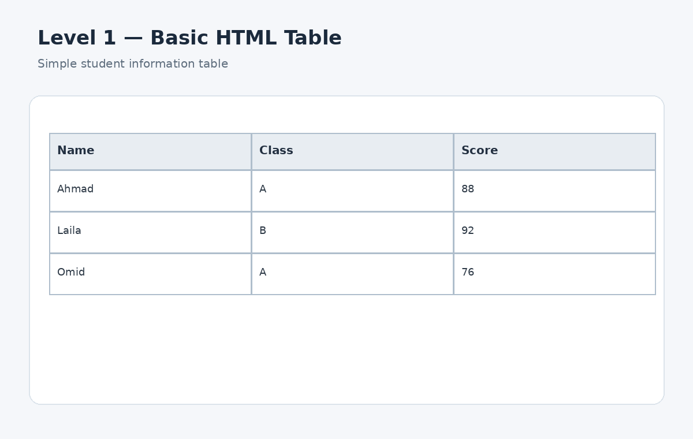
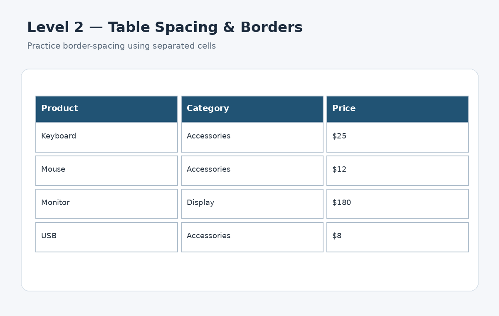
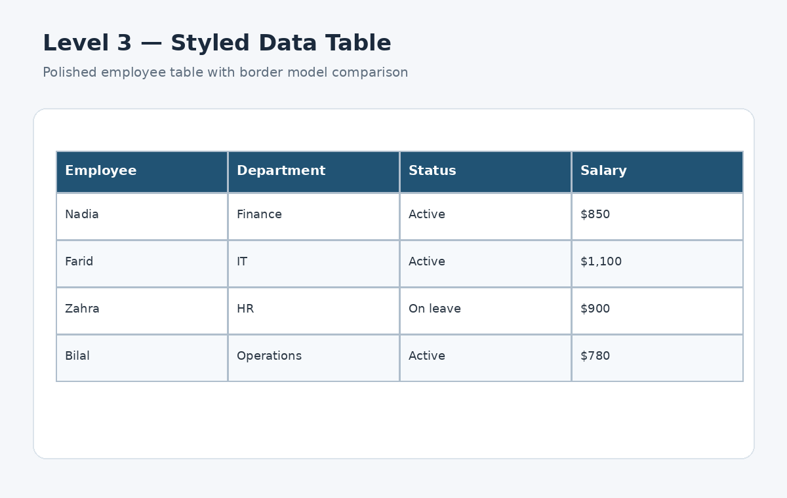

# تمرین‌ های عملی: جدول HTML و استایل‌د هی با CSS

## موضوع: `table`، `th`، `td`، `border-spacing` و `border-collapse`

### هدف

با این تمرین‌ ها ساخت جدول HTML، استایل‌ دهی حاشیه ‌ها و تنظیم فاصله میان خانه‌ های جدول را تمرین کنید. هر شاگرد یک سطح را انتخاب و تکمیل کند.

---

## سطح ۱ — آسان: جدول معلومات شاگردان

**هدف:** ساخت جدول ساده با ساختار درست HTML.

### دستور کار

1. فایل `index.html` ایجاد کنید.
2. جدول با سه ستون `Name`، `Class` و `Score` بسازید.
3. عنوان ستون‌ها را با `th` و حداقل سه سطر معلومات را با `td` درج کنید.
4. برای جدول و خانه‌ها حاشیه ساده CSS تعیین کنید.
5. `padding` خانه‌ها را تنظیم کنید تا متن خوانا باشد.

**شرایط:** استفاده از `table`، `tr`، `th` و `td`؛ حداقل ۳ شاگرد؛ جدول خوانا و منظم.

### تصویر نمونه خروجی

---

## سطح ۲ — متوسط: جدول محصولات با فاصله خانه‌ها

**هدف:** تمرین `border-spacing` و مشاهده تأثیر آن.

### دستور کار

1. جدول محصولات با ستون‌های `Product`، `Category` و `Price` بسازید.
2. حداقل ۴ محصول درج کنید.
3. برای جدول و خانه‌ها `border` تعیین کنید.
4. `border-collapse` را روی `separate` قرار دهید.
5. با `border-spacing` فاصله افقی و عمودی خانه‌ها را تنظیم کنید.
6. مقدار spacing را چند بار تغییر داده و نتیجه را مشاهده کنید.

**شرایط:** فاصله خانه‌ها واضح باشد؛ عنوان‌ها با `th`؛ حتماً `border-spacing` استفاده شود.

### تصویر نمونه خروجی

---

## سطح ۳ — دشوار: جدول گزارش کارمندان

**هدف:** ساخت جدول استایل‌شده و مقایسه حالت‌های جدا و ادغام حاشیه‌ها.

### دستور کار

1. جدول با چهار ستون `Employee`، `Department`، `Status` و `Salary` بسازید.
2. حداقل ۴ کارمند درج کنید.
3. برای عنوان و خانه‌ها رنگ، `padding` و `border` مناسب تعریف کنید.
4. `border-collapse: separate` را فعال و `border-spacing` تنظیم کنید.
5. سپس `border-collapse: collapse` را فعال کنید.
6. تفاوت دو حالت را در ۲ تا ۳ جمله توضیح دهید.
7. جدول را مرتب و خوانا نگه دارید.

**شرایط:** هر دو حالت آزمایش شوند؛ spacing در حالت separate تنظیم شود؛ کد مرتب باشد.

### تصویر نمونه خروجی

---

## طریقه تسلیم

- فایل `index.html` و CSS (داخلی یا جداگانه) را تسلیم کنید.
- سطح انتخاب‌شده را در نام پروژه یا README ذکر نمایید.
- از نتیجه نهایی در مرورگر screenshot بگیرید.
- سطح ۳: توضیح مقایسه `separate` و `collapse` را نیز ضمیمه کنید.
