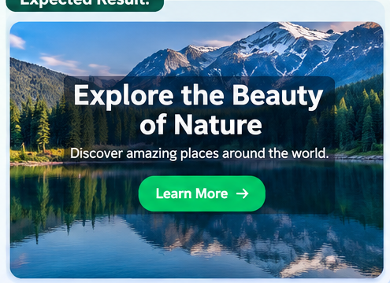
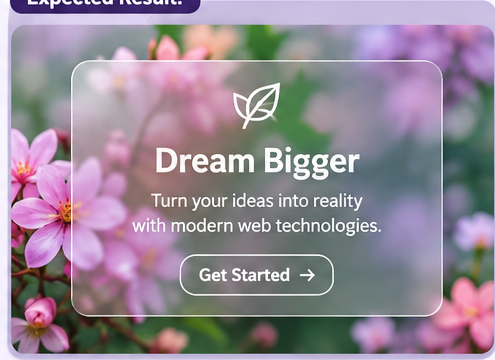

# تمرین‌های عملی CSS: تصاویر، تصویر پس‌زمینه و Backdrop Filter

**موضوع درس:** CSS Images, Background Images & Backdrop Filter  
**نوع تمرین:** عملی  
**فایل‌های مورد نیاز:** `index.html`، `style.css` و پوشهٔ `images`

## هدف کلی

در این تمرین‌ها باید با استفاده از HTML و CSS، تصاویر را به‌شکل مناسب نمایش دهید، نحوهٔ برش و موقعیت تصویر را کنترول کنید، تصویر پس‌زمینه بسازید و از افکت `backdrop-filter` برای ایجاد پنل شیشه‌ای استفاده نمایید.

**نکته:** در این تمرین‌ها کد آماده ارائه نشده است. هنرجو باید با استفاده از آموخته‌های خود، ساختار HTML و استایل‌های CSS را طراحی و پیاده‌سازی کند.

---

## تمرین اول — سطح ابتدایی: کارت معرفی با تصویر

**هدف:** تمرین نمایش تصویر، اندازه‌بندی و شکل‌دهی تصویر با CSS.

### نیازمندی‌ها

1. یک صفحهٔ وب ساده برای معرفی یک شخص بسازید.
2. یک تصویر مناسب برای شخص انتخاب کنید.
3. تصویر باید به‌شکل دایره‌ای نمایش داده شود.
4. اندازهٔ تصویر باید منظم باشد و در صفحه از اندازهٔ تعیین‌شده بیشتر نشود.
5. نام شخص، عنوان وظیفه و یک توضیح کوتاه را زیر تصویر نمایش دهید.
6. برای تصویر یک حاشیه و سایهٔ ظریف در نظر بگیرید.
7. گوشه‌های کارت باید گرد باشد.
8. فاصله‌گذاری میان تصویر و متن‌ها باید منظم باشد.
9. کارت باید در صفحه به‌صورت منظم و در مرکز قرار گیرد.

### نتیجهٔ مورد انتظار

نمونهٔ تصویری زیر فقط راهنمای ظاهری است؛ می‌توانید رنگ‌ها و جزئیات طراحی را خلاقانه تغییر دهید.

### شرایط تحویل

- فایل `index.html`
- فایل `style.css`
- تصویر مورد استفاده در پوشهٔ `images`
- نمایش درست صفحه در مرورگر

### معیار ارزیابی — ۱۰۰ نمره

| معیار | نمره |
|---|---:|
| ساختار درست HTML | ۲۰ |
| نمایش و اندازه‌بندی تصویر | ۲۵ |
| شکل دایره‌ای، حاشیه و سایه | ۲۰ |
| طراحی و فاصله‌گذاری کارت | ۲۰ |
| نظم فایل‌ها و نمایش در مرورگر | ۱۵ |
| **مجموع** | **۱۰۰** |

---

## تمرین دوم — سطح متوسط: بخش اصلی وب‌سایت با تصویر پس‌زمینه

**هدف:** تمرین `background-image`، اندازه و موقعیت پس‌زمینه، لایهٔ رنگی و طراحی واکنش‌گرا.

### نیازمندی‌ها

1. یک تصویر طبیعت، کوهستان، دریا یا منظره انتخاب کنید.
2. تصویر باید به‌عنوان پس‌زمینهٔ بخش اصلی صفحه نمایش داده شود.
3. تمام بخش اصلی صفحه باید با تصویر پوشانده شود.
4. تصویر نباید تکرار شود.
5. تصویر باید در مرکز بخش قرار گیرد.
6. یک لایهٔ تیره و نیمه‌شفاف روی تصویر ایجاد کنید تا متن به‌خوبی خوانده شود.
7. یک عنوان در مرکز صفحه قرار دهید.
8. زیر عنوان، یک متن کوتاه و مرتبط بنویسید.
9. یک دکمه با عنوان **Learn More** اضافه کنید.
10. عنوان، متن و دکمه باید در اندازه‌های مختلف صفحه قابل مشاهده باشند.
11. در صفحهٔ موبایل نیز چیدمان باید منظم باقی بماند.

### نتیجهٔ مورد انتظار

نمونهٔ تصویری زیر راهنمای طراحی بخش اصلی با تصویر پس‌زمینه است.

### شرایط تحویل

- فایل `index.html`
- فایل `style.css`
- تصویر پس‌زمینه در پوشهٔ `images`
- تصویر نهایی از نتیجهٔ کار در مرورگر

### معیار ارزیابی — ۱۰۰ نمره

| معیار | نمره |
|---|---:|
| انتخاب و تنظیم تصویر پس‌زمینه | ۲۵ |
| موقعیت، اندازه و جلوگیری از تکرار تصویر | ۲۰ |
| لایهٔ تیره و خوانایی متن | ۲۰ |
| عنوان، توضیح و دکمه | ۲۰ |
| واکنش‌گرایی و نظم فایل‌ها | ۱۵ |
| **مجموع** | **۱۰۰** |

---

## تمرین سوم — سطح دشوار: طراحی پنل شیشه‌ای روی تصویر

**هدف:** ترکیب مهارت‌های تصاویر، پس‌زمینه، شفافیت و `backdrop-filter`.

### نیازمندی‌ها

1. یک صفحهٔ معرفی برای یک هتل، مرکز گردشگری یا مکان تفریحی طراحی کنید.
2. برای پس‌زمینهٔ صفحه یک تصویر باکیفیت و مرتبط انتخاب کنید.
3. تصویر پس‌زمینه باید تمام بخش اصلی صفحه را بپوشاند و تکرار نشود.
4. یک پنل شیشه‌ای در مرکز صفحه ایجاد کنید.
5. پنل باید پس‌زمینهٔ نیمه‌شفاف داشته باشد.
6. از افکت `backdrop-filter` برای تار کردن بخش تصویر پشت پنل استفاده کنید.
7. در صورت نیاز، افکت‌های دیگری مانند افزایش اشباع رنگ یا روشنایی را به‌شکل متعادل ترکیب کنید.
8. برای پنل حاشیهٔ ظریف، گوشه‌های گرد و سایهٔ مناسب در نظر بگیرید.
9. داخل پنل موارد زیر را نمایش دهید:
   - نام مکان
   - یک تصویر کوچک مرتبط
   - توضیح کوتاه
   - سه ویژگی یا خدمت مهم
   - یک دکمه با عنوان **Explore More**
10. تصویر کوچک داخل پنل باید اندازهٔ مناسب داشته باشد و در صورت نیاز، برش آن به‌شکل درست تنظیم شود.
11. طراحی باید در صفحه‌های بزرگ و کوچک قابل استفاده باشد.
12. متن داخل پنل باید روی تصویر پس‌زمینه به‌خوبی خوانده شود.
13. اگر افکت `backdrop-filter` در مرورگر پشتیبانی نشد، پنل باید همچنان پس‌زمینهٔ قابل خواندن داشته باشد.

### نتیجهٔ مورد انتظار

نمونهٔ تصویری زیر راهنمای طراحی پنل شیشه‌ای با افکت backdrop-filter است.

### شرایط تحویل

- فایل `index.html`
- فایل `style.css`
- پوشهٔ `images` شامل تمام تصاویر استفاده‌شده
- تصویر نهایی از نتیجهٔ کار در مرورگر
- پروژه باید بدون خطای مسیر فایل‌ها اجرا شود.

### معیار ارزیابی — ۱۰۰ نمره

| معیار | نمره |
|---|---:|
| تصویر پس‌زمینه و تنظیمات آن | ۱۵ |
| پیاده‌سازی درست پنل شیشه‌ای | ۲۵ |
| استفادهٔ مناسب از `backdrop-filter` | ۱۵ |
| طراحی و محتوای داخل پنل | ۱۵ |
| استایل‌دهی تصاویر، حاشیه و سایه | ۱۰ |
| واکنش‌گرایی و خوانایی | ۱۵ |
| نظم و تکمیل فایل‌های پروژه | ۵ |
| **مجموع** | **۱۰۰** |

---

## نکات مهم برای هر سه تمرین

- از نام‌گذاری واضح برای فایل‌ها و تصاویر استفاده کنید.
- تمام تصاویر باید در پوشهٔ `images` نگهداری شوند.
- مسیر تصاویر باید درست باشد.
- از تصاویر باکیفیت و متناسب با موضوع استفاده کنید.
- طراحی باید ساده، منظم و قابل استفاده باشد.
- از افکت‌ها بیش از اندازه استفاده نکنید.
- پروژه را در مرورگر بررسی کنید و از نتیجهٔ نهایی تصویر بگیرید.

**یادآوری:** هدف فقط نوشتن CSS نیست؛ هدف این است که بتوانید با انتخاب درست تصویر، اندازه‌بندی، برش، موقعیت و افکت‌های بصری، یک رابط کاربری زیبا و قابل استفاده طراحی کنید.
